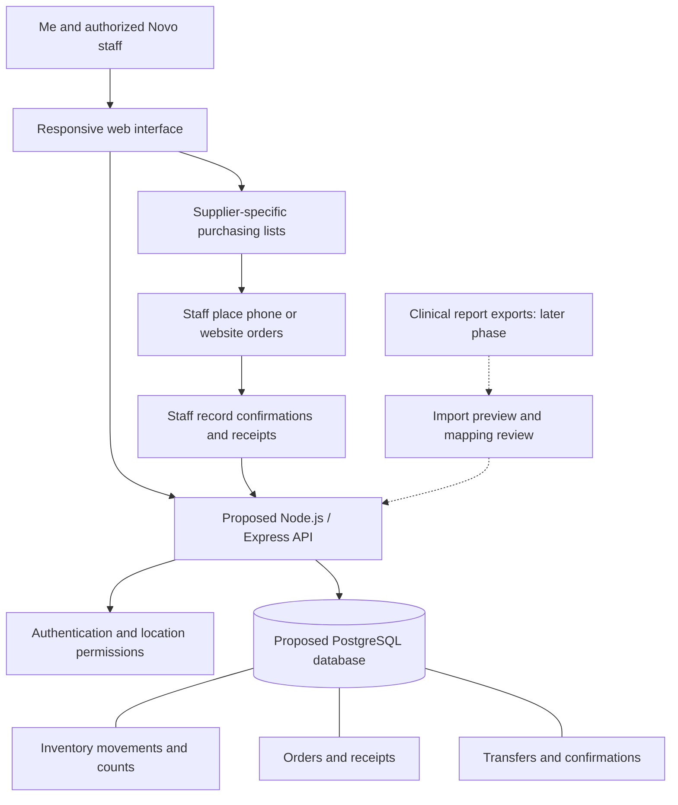

# Novo Dialysis Supply Hub

> A shared inventory and ordering workspace for me to coordinate supplies across Novo Dialysis locations.

**Author:** Keith Mora · **Course:** CMP 464/343 Product 1 · **Last updated:** November 2, 2026

---

## 1. About Me 

I coordinate ordering and inventory for multiple Novo Dialysis locations, including Jamaica and Flatland. I work with medication suppliers, order main supplies by phone, and replenish office, bathroom, and breakroom essentials through Amazon. I also review clinical reports to understand patient activity and weekly medication and supply usage.

I currently organize this work in an Excel workbook with supplier lists, location-specific counts, order history, and weekly medication summaries. For this course, I am turning that real operational problem into a product I would use myself.

**The last 3 times this happened:**

*These need my actual experiences; dates, consequences, and workarounds have not yet been documented. The prompts below are examples to investigate, not claims that these incidents occurred.*

1. **Weekly ordering:** [When and where did I last prepare orders? What was difficult about gathering counts and deciding quantities? How long did it take, and what did I do?]
2. **A shortage or location imbalance:** [When did one location need something another location had? What went wrong, what did it cost, and how did I resolve it?]
3. **A usage review or delivery:** [When did I last compare weekly medication usage or reconcile a delivery with an order? What was missing, what did it cost, and what did I do?]

**What it costs me:**

- ⏱️ **Time:** Weekly ordering is a recurring responsibility. [Measure minutes spent gathering counts, reviewing reports, ordering, and checking deliveries each week.]
- 💸 **Money:** [Record any actual rush shipping, duplicate purchases, waste, or unnecessary stock. Amounts are not yet measured.]
- 🔋 **Energy:** I have to bring together information from spreadsheets, reporting sites, purchasing sites, and phone conversations. [Describe a recent example of the effort this required.]
- 🙂 **Joy:** [Describe how this work affects my day and what I would rather spend that time on.]

---

## 2. Problem Statement

**Gut check:**

> I need a reliable way to know what each Novo location has and what to buy for the coming week because my counts, usage reports, and purchasing records are spread across several places.

**Five Whys:**

*Working root-cause analysis to validate against my recent experiences.*

1. **Why is weekly replenishment difficult?** I need to compare each location's remaining supplies with its expected needs.
2. **Why is that comparison difficult?** Counts, treatment usage, and purchasing records are kept separately.
3. **Why does keeping them separately create extra work?** I have to reconcile the information myself before deciding quantities.
4. **Why does reconciliation require judgment?** Suppliers use different package sizes, locations have different needs, and an order is different from a confirmed delivery.
5. **Why does this problem keep recurring?** I do not yet have one consistent process connecting counts, purchasing, deliveries, and movements between locations.

**Problem statement:**

> **When** I prepare the coming week's supply orders for Jamaica and Flatland, **I struggle to** bring together current quantities, recent usage, outstanding purchases, and supplies moving between locations, **which costs me** repeated checking and reconciliation each week; the time and dollar amounts still need to be measured. **This happens because** those records are separated across spreadsheets, clinical reporting sites, supplier sites, and phone conversations. **Right now I** maintain an Excel workbook and consult those sources separately, **but** I still have to reconcile units, dates, and locations myself.

**I'll know this is solved when:** I can prepare a reviewed weekly purchasing list for each location from current counts and confirmed incoming supplies, explain every suggested quantity, and account for deliveries and inter-location movements without rebuilding the same comparison in Excel. I will measure preparation time before and after; a numerical improvement target will follow the baseline.

---

## 3. Existing Solutions

| What I use or tried | What it does well | Why it falls short *for me* |
| --- | --- | --- |
| My Excel master workbook | Keeps supplier item numbers, location ordering lists, counts, historical orders, and medication summaries together. | Counts and histories need manual upkeep; layouts and units differ between sheets. |
| Clinical reporting sites used by nurses and technicians | Contain daily treatment activity and medication / supply usage for selected dates. | I still need to connect those reports to purchasing quantities and inventory at each location. Exact sites and export options remain to be confirmed. |
| Cardinal Vantus and Proficient Rx | Provide the medication purchasing channels I use. | Purchasing records alone do not explain all locations' remaining stock or weekly needs. |
| Phone orders with Fresenius and Henry Schein | Let me order main dialysis supplies directly. | I need a separate record of what I requested, what was confirmed, and what arrived. |
| Amazon | Provides office, bathroom, and breakroom supplies. | Those purchases still need to be associated with the right location and replenishment needs. |

**The gap:** I need a consistent connection between each location's current supplies, expected needs, purchases, deliveries, and inter-location movements.

---

## 4. Features & Benefits

| Feature (what it does) | Benefit (how my life gets better) | MVP or Later? |
| --- | --- | --- |
| Per-location inventory with count dates, explicit units, replenishment targets, and low-stock indicators. | I can see what Jamaica and Flatland have without comparing separate sheets or mistaking a missing count for zero. | MVP |
| Supplier-specific order lists with manual order confirmation and receiving. | I can prepare phone or website orders in one place and distinguish what I intend to buy from what actually arrived. | MVP |
| Transfer log with dispatch and receipt confirmation. | I can move supplies between locations without losing the handoff or counting the same stock twice. | MVP |
| Date-filtered usage imports and weekly planning calculations. | I can base future purchasing on actual activity while reviewing the assumptions and package conversions. | Later |
| Authorized direct retrieval from reporting sites, where supported. | I can reduce repeated report downloads after the source systems and access requirements are verified. | Later |
| Lot / expiration controls, approval rules, and additional notifications. | I can handle more detailed operational needs as the basic workflow becomes reliable. | Later, subject to launch requirements |

### MVP (2–3 features)

1. **Know what each location has:** reviewed catalog, manual counts, units, count dates, and location-specific replenishment settings.
2. **Prepare and receive orders:** group needs by supplier and location, record phone or website confirmations, and credit confirmed deliveries.
3. **Move supplies between locations:** record source, destination, quantity, dispatcher, and receiver with correct inventory effects.

The usable MVP also needs sign-in, shared storage, appropriate location permissions, and an audit history. The current visual sketch does not yet provide those foundations.

### Later

- Weekly treatment and medication report imports with date filters, mapping review, and duplicate detection.
- Forecasts using verified consumption, lead times, safety stock, and package sizes.
- Supported direct reporting connections after verifying permissions and technical capabilities.
- More detailed expiration handling, approvals, exports, and notifications according to staff needs.

### Not doing

- Prescribing medication, recommending patient doses, or replacing the clinical record.
- Automatically placing supplier orders or purchases in the first release.
- Assuming a purchasing portal also provides clinical treatment reports.
- Including patient-level records when aggregate supply usage is sufficient.
- Building a native iPhone app for this version; the agreed surface is the web.

---

## 5. Tech Stack

### Front end

- **Surface:** Responsive web application.
- **Tools:** JavaScript, CSS, and Vite; these are already used in the sketch.
- **Why:** I need to review many items on a computer while also being able to check or enter counts from a phone or tablet at a location.

### Back end

*The choices below are proposals for the MVP, not installed or connected services. Hosting and database choices still need confirmation.*

| Piece | Choice | Why |
| --- | --- | --- |
| Server / API | Proposed: Node.js with Express | Keeps the front end and server in JavaScript and provides a place to enforce permissions and validate stock changes. |
| Data storage | Proposed: PostgreSQL | Supports related locations, items, orders, and transfers, with transactions to prevent duplicate or incomplete stock changes. |
| Authentication | To be selected | Needs individual accounts, location access, and secure session handling before real operational use. |
| Outside services (optional) | Manual supplier portal links in the MVP; reviewed report exports later | Supports the existing purchasing routes without relying on unverified integrations. |
| Hosting / deploy | To be selected: managed web/API hosting and managed PostgreSQL | Requires a decision about access, backups, costs, and any sensitive-data requirements before deployment. |

### Architecture sketch



### Current sketch and local development

The current entry point is **Black Edition**, imported from the supplied six-file ZIP. It has a dark dashboard, Jamaica / Flatlands facility selection, editable inventory with cases and loose units, confirmed daily check-ins, local backup controls, and configurable forecasting with CSV export. Inventory and check-in records persist in this browser's localStorage; they are not shared between staff or devices. A fresh browser starts with an empty catalog. Back up browser data before clearing site storage.

Forecast treatment counts and starting usage rates are editable demonstration assumptions, not verified clinical data. Confirm all quantities and conversions before purchasing. Vendor purchasing, orders/deliveries, RenVio reports, and notifications are placeholders. Transfers are not implemented in Black Edition. No clinical reporting source or live integration has been verified.

The earlier light sketch is preserved under `legacy/light-edition/` and can be opened through the development server at `/legacy/light-edition/`. Its in-memory inventory, order drafts, and transfer interactions are separate from Black Edition storage. The unused original `src/` entry has been archived there.

Requires Node.js 20.19+ on the 20.x line, or 22.12+. Use a supported LTS release.

```sh
npm ci
npm run dev
```

Open the address printed by Vite, or use the hosted workspace's port preview if available.

```sh
npm run build
npm run preview
```

The Black Edition static build and JavaScript syntax checks passed. DOM-based checks exercised startup, navigation, inventory creation and saving, rejection of unconfirmed check-ins, confirmed check-in history, forecasting settings, and dashboard alerts. Backup controls, CSV downloads, browser visual fidelity, and production security have not been fully validated. These checks do not establish production readiness or validate medication calculations.

`npm run build` copies the six static application files into `dist/`; `npm run preview` serves that output. The root HTML loads classic scripts in order: `inventory.js`, `app.js`, `forecast.js`, then `dashboard.js`. No bundling is required for this edition.

The more detailed operational requirements, migration rules, data model, acceptance criteria, and implementation limitations are preserved in [the full product specification](docs/product-specification.md).

---

## 6. Open Questions

- What name should appear as the author, and what is my exact role at Novo?
- What were my last three real incidents, and what did each cost in time, money, effort, or frustration?
- How long does preparing a weekly order take today, and what measurable reduction would count as success?
- What are the exact clinical reporting sites, and can I export their reports as CSV or Excel?
- Do their counts represent unique patients or treatment sessions, and what dates define my normal reporting week?
- What are the verified pack sizes and unit conversions for each supply and medication?
- Which items come from Cardinal Vantus versus Proficient Rx?
- Who can change counts, place orders, approve purchases, and confirm deliveries or transfers at each location?
- What are the supplier lead times, order cutoffs, and desired reserve levels?
- Are lot / expiration controls or approval rules essential at launch rather than later?
- Which sign-in, hosting, database, backup, and retention arrangements fit Novo's needs?
- Which additional locations or staff should participate in the first usability test?
